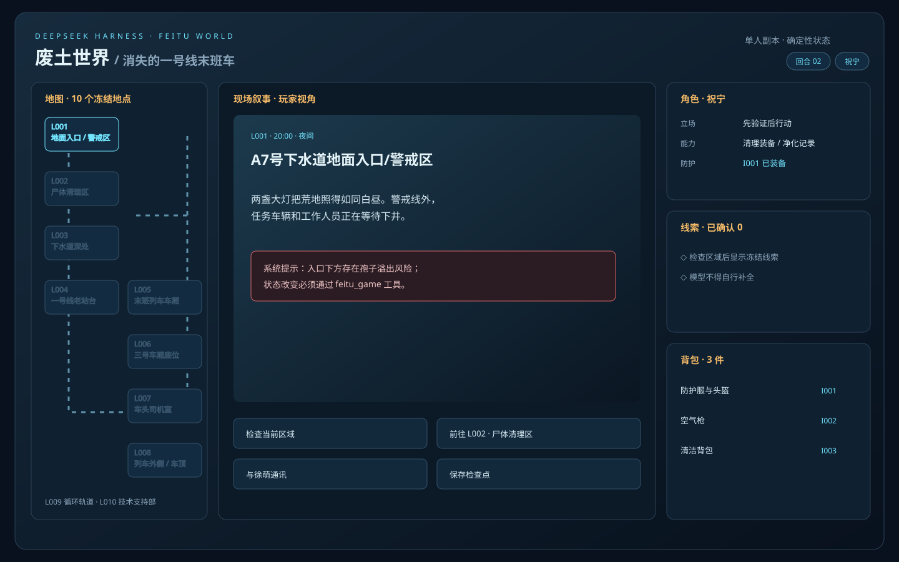

# 玩家视角 UI 预览

这是 DSH 默认对话壳中 `feitu_game` 工具卡片的玩家视角预览：主叙事使用地下站台概念图铺底，地图和第一视角头盔面板收在右上角两个可打开的详情图标中，右侧常驻角色、线索、背包和事实。

`preview.html` 是可点击的离线玩家验收界面；它通过 `server.mjs` 调用同一个 `feitu_game` 运行时，状态数据仍以插件 JSON 输出为唯一事实源。

资源批次还包括 [角色卡](./role-cards.svg)、[终局路线图](./ending-routes.svg)、
[交互事件板](./event-board.svg) 和 [世界枢纽图](./world-hub.svg)；世界枢纽图同时标出
唯一可玩副本与 10 个来源登记但尚未开放的目录条目；它们是原创 SVG，
不依赖外部图片版权或运行时网络。

概念资源：[地下站台氛围图](./station-platform-concept.png) 和
[孢子收容箱道具图](./spore-containment-case.png) 由内置 image_gen 生成，作为可替换的
展示层素材；规则、地图和交互仍以 SVG/JSON/runtime 为准。
